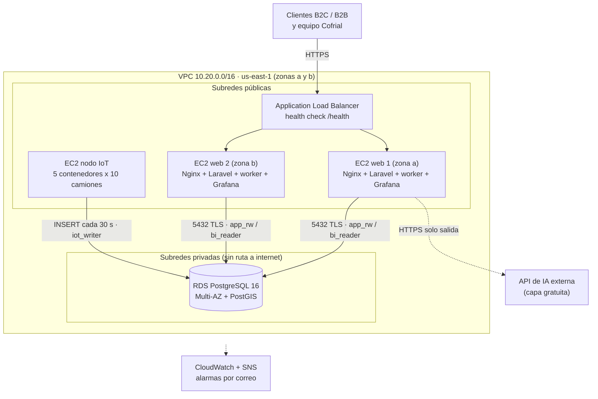

# Cofrial SpA · Plataforma de transformación digital

Monorepo del prototipo que moderniza a **Comercializadora y Frigoríficos Araucanía (Cofrial SpA)**: un portal de ventas B2B/B2C, un CRM, la telemetría IoT simulada de su flota frigorífica y un dashboard de BI, desplegados en AWS Academy sobre una única base de datos PostgreSQL.

> Proyecto académico (Taller de Diseño y Desarrollo de Soluciones · Transformación Digital, Hito 2). Los datos de clientes, precios y telemetría son ficticios.

## Objetivo

Cofrial opera con un servidor único sin respaldo, planillas Excel que no cuadran, 50 camiones sin GPS ni registro de temperatura, y pedidos y cartera de clientes repartidos en teléfonos y grupos de WhatsApp personales. El diagnóstico estima unos **$8,7 millones semanales** en mermas y entregas fallidas.

El sistema reemplaza esos tres focos por una plataforma con una sola fuente de verdad:

| Dolor | Qué entrega este repositorio | Indicador que habilita |
| --- | --- | --- |
| Servidor único y silos de información | Infraestructura en AWS (ALB, 2 EC2, RDS PostgreSQL Multi-AZ) con una base compartida por ventas, CRM, inventario y logística | RPO ≤ 5 min, RTO ≤ 15 min, % de diferencia de inventario |
| Sin canal digital ni CRM (Shadow IT) | Portal transaccional B2B/B2C con carrito y pedidos, y CRM con cartera, pipeline, tickets y pedidos telefónicos | Conversión, pedidos por canal, tiempo de ciclo del pedido |
| Última milla a ciegas | Simulador IoT en Docker que inyecta telemetría cada 30 s y genera alertas de ruptura de frío visibles en CRM y BI | % de mermas, minutos hasta detectar una ruptura |
| Decisiones sin datos | Dashboard Grafana en vivo que cruza ventas con cadena de frío, y una IA de capa gratuita que clasifica tickets y atiende consultas | Todos los anteriores, en un solo panel |

Principio de diseño: **ningún pedido, cliente ni conversación comercial existe fuera del sistema.**

### Qué se evalúa (pauta Hito 2)

1. Despliegue cloud en AWS Academy (EC2 + RDS estables y conectados).
2. E-commerce con carrito y pedidos B2B/B2C, y CRM operativo, conectados a la base en la nube.
3. Simulación IoT con contenedores Docker en EC2 que inyectan `camion_id`, `temp_camara`, `lat`/`long`, `combustible_pct` y `alerta_ruptura_frio`.
4. Dashboard de BI en vivo que cruza métricas comerciales con las de cadena de frío.
5. Integración funcional de una API pública de IA a costo cero y defensa técnica en vivo.

## Arquitectura del sistema



| Componente | Tecnología | Ubicación en el repo |
| --- | --- | --- |
| Portal de ventas + CRM + worker de colas | Laravel (PHP) como monolito modular, Nginx | [`apps/web`](apps/web) |
| Simulador de telemetría IoT | Python en contenedores Docker | [`apps/iot-simulator`](apps/iot-simulator) |
| Base de datos | PostgreSQL 16 + PostGIS (RDS Multi-AZ), 34 tablas en 3FN | [`db`](db), migraciones en `apps/web` |
| Business Intelligence | Grafana OSS servido en `/bi`, usuario de solo lectura | [`infra/grafana`](infra/grafana) |
| IA | API externa con capa gratuita, llamada desde el worker | `apps/web` (módulo IA) |
| Infraestructura | VPC, ALB, EC2, RDS, CloudWatch, SNS | [`infra/aws`](infra/aws), [`infra/docker`](infra/docker) |

El detalle (red, Security Groups, flujos, disponibilidad) está en [`docs/ARCHITECTURE.md`](docs/ARCHITECTURE.md) y el porqué de cada decisión en [`docs/ADR`](docs/ADR).

## Estructura del repositorio

```text
.
├── README.md               Este archivo: objetivo, arquitectura y mapa del repo
├── AGENTS.md               Instrucciones para agentes de IA (y personas) que trabajen aquí
├── CLAUDE.md               Importa AGENTS.md para Claude Code
├── .env.example            Variables de entorno documentadas (sin secretos)
├── .gitignore
├── .editorconfig
│
├── apps/
│   ├── web/                Laravel: portal B2B/B2C, CRM, worker de colas, integración IA
│   └── iot-simulator/      Simulador de telemetría de los 50 camiones (Docker)
│
├── db/                     SQL fuera de las migraciones: roles de mínimo privilegio, vistas de BI
│
├── infra/
│   ├── aws/                Red, RDS, EC2, ALB, monitoreo (scripts/plantillas y runbooks)
│   ├── docker/             Dockerfiles y Compose de desarrollo y de producción
│   └── grafana/            Datasource y dashboards versionados (provisioning)
│
├── docs/
│   ├── ARCHITECTURE.md     Arquitectura cloud y de aplicación
│   ├── DATA_MODEL.md       Modelo relacional: 34 tablas, claves, nulos y catálogos
│   ├── BUSINESS_RULES.md   Perfiles, reglas RN-01…RN-11 y máquinas de estado
│   ├── API.md              Rutas HTTP, contrato de telemetría y contrato con la IA
│   ├── SECURITY.md         Controles de seguridad y Ley 21.719
│   ├── ROADMAP.md          Fases, ruta crítica y relación con la pauta
│   └── ADR/                Registros de decisiones de arquitectura
│
└── tasks/
    ├── README.md           Índice general de tareas, estado y dependencias
    ├── _plantilla/         Plantilla para tareas nuevas
    └── T-0NN-<slug>/       Una carpeta por tarea, con su README.md
```

## Cómo se trabaja en este repositorio

El desarrollo está organizado para que personas y agentes de IA (por ejemplo, Claude Code) puedan avanzar tarea a tarea sin perder contexto:

1. Lee [`AGENTS.md`](AGENTS.md): convenciones, límites y definición de terminado.
2. Elige una tarea en [`tasks/README.md`](tasks/README.md) cuyas dependencias estén terminadas.
3. Trabaja dentro del alcance de esa tarea; sus criterios de aceptación definen cuándo está lista.
4. Si tomas una decisión de arquitectura, regístrala como ADR en [`docs/ADR`](docs/ADR).
5. Actualiza el estado de la tarea en el índice y la documentación que tu cambio vuelva obsoleta.

Ejemplo de instrucción a un agente: *«Implementa la tarea `tasks/T-010-carrito`. Sigue AGENTS.md y detente cuando se cumplan los criterios de aceptación.»*

## Puesta en marcha

Todo el sistema local (PostgreSQL + PostGIS, aplicación, worker, Nginx y Grafana) se levanta con Docker Compose. El paso a paso completo está en [`infra/docker/README.md`](infra/docker/README.md) y los comandos de la aplicación en [`apps/web/README.md`](apps/web/README.md).

```bash
cp .env.example .env
```

```bash
docker compose -f infra/docker/compose.dev.yml up -d
```

Luego abre `http://localhost:8080` (portal), `/crm`, `/health` y `/bi` (Grafana).

## Estado

Andamiaje y documentación listos; implementación pendiente. El avance real se lleva en [`tasks/README.md`](tasks/README.md) y el plan en [`docs/ROADMAP.md`](docs/ROADMAP.md).
