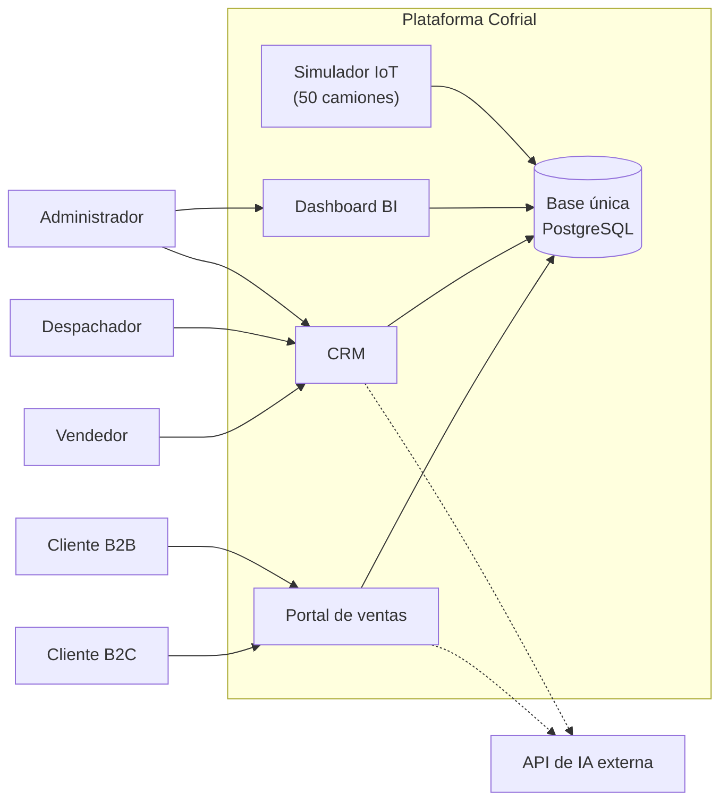

# Arquitectura

Describe cómo está construido y desplegado el sistema. El porqué de cada elección está en [`ADR/`](ADR/README.md); aquí se cita el ADR correspondiente entre paréntesis.

## 1. Requisitos que guían la arquitectura

Cada componente responde a un problema medido en el diagnóstico. Si una pieza no está ligada a uno de estos drivers, no entra.

| ID | Driver | Requisito |
| --- | --- | --- |
| D1 | Servidor único sin respaldo (RPO hasta 7 días, RTO > 24 h) | Ningún componente crítico en una sola zona. Meta: RPO ≤ 5 min, RTO ≤ 15 min ante la caída de una zona |
| D2 | Silos y planillas Excel (8 % de diferencia de inventario) | Una sola base relacional con transacciones ACID para ventas, CRM, inventario y logística |
| D3 | 50 camiones sin telemetría | Ingesta continua en un nodo separado del portal, para que la telemetría no degrade las ventas |
| D4 | Rupturas de frío no detectadas (2 % de entregas) | Alerta en minutos, visible en el dashboard y notificada al equipo |
| D5 | Shadow IT y Ley 21.719 | Base en red privada, cifrado en reposo y en tránsito, acceso por rol, conservación acotada de la telemetría |
| D6 | Clientes sin canal digital | Un único punto de entrada desde internet, con dirección estable |
| D7 | Despliegue en AWS Academy | Solo servicios disponibles en el Learner Lab y dentro de los créditos; Docker sobre EC2 es obligatorio |
| D8 | BI e IA a costo cero | Herramientas open source dentro de la VPC y una API de IA externa consumida por salida HTTPS |

## 2. Vista de contexto



Portal y CRM son dos módulos de la misma aplicación Laravel (ADR-0013). El simulador sustituye a los sensores reales de la flota: en una implantación real, ese lugar lo ocuparía un gateway de telemetría.

## 3. Infraestructura en AWS

Región `us-east-1`, zonas `us-east-1a` y `us-east-1b` (ADR-0001).

### 3.1 Red

VPC propia `cofrial-vpc` · `10.20.0.0/16` (ADR-0002, ADR-0003).

| Subred | CIDR | Zona | Tabla de rutas | Contiene |
| --- | --- | --- | --- | --- |
| `publica-a` | `10.20.1.0/24` | us-east-1a | `rt-publica` (0.0.0.0/0 → Internet Gateway) | ALB, EC2 web 1, nodo IoT |
| `publica-b` | `10.20.2.0/24` | us-east-1b | `rt-publica` | ALB, EC2 web 2 |
| `datos-a` | `10.20.21.0/24` | us-east-1a | `rt-datos` (solo ruta local) | RDS primaria |
| `datos-b` | `10.20.22.0/24` | us-east-1b | `rt-datos` | RDS en espera (Multi-AZ) |

No hay NAT Gateway: las EC2 tienen IP pública para salir a internet y su Security Group solo admite tráfico entrante desde el balanceador.

### 3.2 Security Groups encadenados (ADR-0004)

| Grupo | Entrada permitida | Origen |
| --- | --- | --- |
| `sg-alb` | 443 (y 80 para redirigir) | Internet |
| `sg-web` | 80 | `sg-alb` |
| `sg-web` | 22 | IP del equipo `/32` |
| `sg-iot` | 22 | IP del equipo `/32` |
| `sg-db` | 5432 | `sg-web`, `sg-iot` |

Las NACL quedan por defecto. `sg-db` tampoco abre salida a internet: su única regla de salida es 5432 dentro de la VPC.

La red completa es el stack `cofrial-red` ([`infra/aws/red.yaml`](../infra/aws/red.yaml), ADR-0018); `infra/aws/verificar-red.sh` comprueba estas reglas contra la cuenta.

### 3.3 Cómputo

| Nodo | Tipo | Ejecuta (Docker Compose) | ADR |
| --- | --- | --- | --- |
| EC2 web 1 (zona a) | t3.medium | Nginx, Laravel (portal + CRM), worker de colas, Grafana en `/bi` | 0005 |
| EC2 web 2 (zona b) | t3.medium | Igual que web 1; ambas atienden a la vez | 0005 |
| Nodo IoT (zona a) | t3.small | 5 contenedores del simulador × 10 camiones | 0006 |

El ALB revisa `GET /health` cada 30 s y saca de rotación la instancia que falle. El nodo IoT no se duplica: si falla, solo se pausa la simulación y los contenedores se reinician solos (`restart: unless-stopped`).

### 3.4 Datos

RDS for PostgreSQL 16, `db.t3.micro`, Multi-AZ, con PostGIS (ADR-0007, ADR-0009):

- Sin acceso público, cifrada con KMS, TLS obligatorio.
- Respaldos automáticos de 7 días con recuperación a un punto en el tiempo; snapshot manual antes de la defensa.
- Una sola base para ventas, CRM, inventario, telemetría, sesiones, colas y la base interna de Grafana.

Volumen esperado de telemetría: 50 camiones × 1 lectura cada 30 s = 144.000 filas al día (≈ 17 MB/día, ≈ 6 GB/año). PostgreSQL lo maneja con un índice por `(camion_id, fecha_hora)`; no justifica una base NoSQL aparte.

### 3.5 Monitoreo (ADR-0011)

Alarmas de CloudWatch que notifican por SNS al correo del equipo:

- Instancia no saludable en el ALB.
- Chequeo de estado fallido en una EC2.
- CPU sobre 80 %.
- Poco espacio libre en RDS.

Las alertas de ruptura de frío no pasan por CloudWatch: las emite la aplicación al despachador.

### 3.6 Flujos numerados

1. Clientes y equipo entran desde internet por el Internet Gateway al ALB.
2. El ALB reparte entre EC2 web 1 y 2 (HTTP 80, solo desde `sg-alb`).
3. Las EC2 web leen y escriben en RDS por 5432 con TLS (`app_rw`); Grafana lee con `bi_reader`.
4. Los simuladores insertan cada 30 s la lectura de cada camión y sus alertas (`iot_writer`).
5. El worker de colas consulta la API de IA externa por HTTPS, solo de salida.
6. CloudWatch recibe métricas de ALB, EC2 y RDS; SNS avisa por correo.

Si cae la zona A, RDS promueve la réplica de la zona B y el ALB envía todo el tráfico a EC2 web 2.

## 4. Arquitectura de la aplicación

### 4.1 Aplicación web (`apps/web`)

Monolito modular en Laravel. Un solo despliegue, cinco dominios que calzan con los del modelo de datos:

| Módulo | Responsabilidad | Tablas principales |
| --- | --- | --- |
| Clientes y accesos | Autenticación, roles, registro B2C/B2B, validación de empresas | `usuario`, `rol`, `cliente`, `contacto_cliente`, `direccion_despacho` |
| Catálogo e inventario | Productos, listas de precios, stock y sus movimientos | `producto`, `detalle_lista_precio`, `inventario`, `movimiento_inventario` |
| Ventas | Carrito, checkout, pedidos, pagos simulados, estados | `carrito`, `pedido`, `detalle_pedido`, `pago`, `historial_estado_pedido` |
| CRM | Panel, cartera, pipeline, interacciones, tickets | `oportunidad`, `historial_etapa`, `interaccion`, `ticket` |
| Logística | Despachos, flota, lectura de telemetría, alertas de frío | `despacho`, `despacho_pedido`, `camion`, `telemetria`, `alerta` |

Dos superficies sobre los mismos módulos:

- **Portal** (`/`): clientes B2C y B2B.
- **CRM** (`/crm`): vendedor, despachador y administrador, con menú por rol.

Estructura objetivo dentro de `apps/web/app`:

```text
app/
├── Domain/            Lógica de negocio por módulo (servicios, acciones, reglas)
│   ├── Clientes/
│   ├── Catalogo/
│   ├── Ventas/
│   ├── Crm/
│   ├── Logistica/
│   └── Ia/
├── Models/            Modelos Eloquent (uno por tabla del MER)
├── Http/
│   ├── Controllers/Portal/
│   ├── Controllers/Crm/
│   └── Middleware/
├── Jobs/              Trabajos de cola (IA, expiración de reservas, notificaciones)
└── Policies/          Autorización por rol
```

**Sin estado en la instancia.** Sesiones, caché y colas se guardan en la base (ADR-0005), de modo que cualquiera de las dos EC2 atiende a cualquier usuario.

**Trabajos en segundo plano** (worker de colas y planificador):

| Trabajo | Disparador | Efecto |
| --- | --- | --- |
| Clasificar ticket con IA | Al crear un ticket | Completa `categoria`, `prioridad`, `clasificado_por_ia`; si falla, queda manual |
| Expirar reservas B2C | Cada minuto | Cancela pedidos `Pendiente` sin pago tras 30 min y libera `stock_reservado` |
| Marcar carritos abandonados | Cada hora | Carritos sin actividad por 24 h pasan a `abandonado` |
| Notificar alerta de frío | Al detectar una alerta nueva | Avisa al despachador y al vendedor de los clientes afectados |

### 4.2 Simulador IoT (`apps/iot-simulator`)

Proceso Python empaquetado en una imagen Docker (ADR-0014). Cada contenedor simula 10 camiones; cinco contenedores cubren la flota.

Por cada camión y cada 30 s:

1. Avanza la posición sobre una ruta de la macrozona sur.
2. Genera `temp_camara` alrededor del punto de consigna de su carga y, con baja probabilidad, inicia un episodio de ruptura de frío que dura varios ciclos.
3. Reduce `combustible_pct`.
4. Calcula `alerta_ruptura_frio` comparando la temperatura con el rango de conservación aplicable.
5. Inserta la fila en `telemetria` y, si hay ruptura, un registro en `alerta`.

El contrato exacto está en [`API.md`](API.md#2-contrato-de-telemetría-iot).

### 4.3 Business Intelligence

Grafana OSS corre en cada EC2 web y se sirve bajo `/bi` a través de Nginx (ADR-0010). Usa la misma RDS como base interna para que el dashboard sea idéntico en ambas instancias, y consulta los datos de negocio con `bi_reader` sobre vistas `bi_*` definidas en [`db/`](../db). Los dashboards se versionan como JSON en [`infra/grafana`](../infra/grafana).

Paneles mínimos: ventas por día y por canal, pedidos por estado, conversión del pipeline, mapa y temperatura de la flota, alertas de frío abiertas, y el cruce **pedidos y clientes afectados por alertas de frío**. El dashboard se actualiza cada 30 s y se carga por provisioning al arrancar Grafana; el detalle de paneles y vistas está en [`infra/grafana/README.md`](../infra/grafana/README.md).

Un pedido se considera afectado por una ruptura si estaba en una parada aún no entregada de un despacho que su camión tenía en ruta en el momento de la lectura que originó la alerta (`bi_pedido_afectado_alerta`).

### 4.4 Integración de IA

Una API de modelo de lenguaje con capa gratuita, llamada por HTTPS desde el servidor: Groq (`openai/gpt-oss-20b`) y Gemini de respaldo, ambos por su endpoint compatible con OpenAI (ADR-0015). Dos usos:

- **Clasificación de tickets**: asíncrona, en el worker de colas.
- **Asistente del portal**: responde consultas de estado de pedido y de catálogo con datos que el servidor obtiene de la base; si no puede resolver, deriva a un ticket.

La integración se aísla detrás de una interfaz (`App\Domain\Ia\ClienteIa`) para poder cambiar de proveedor. Nunca se envían RUT ni nombres, y una falla de la API no bloquea la venta.

## 5. Entornos

| Entorno | Dónde | Base de datos | Notas |
| --- | --- | --- | --- |
| Local | Docker Compose en el equipo de cada integrante | Contenedor PostgreSQL 16 + PostGIS | Mismo motor y mismas extensiones que RDS |
| Producción | AWS Academy Learner Lab | RDS Multi-AZ | Certificado autofirmado importado a ACM: el navegador mostrará un aviso |

Consideraciones del Learner Lab que el despliegue debe tolerar:

- Las sesiones caducan y las instancias se detienen: todos los contenedores usan política de reinicio y la aplicación arranca sola.
- Las IP públicas de las EC2 cambian: solo se referencia el DNS del ALB.
- No se pueden crear roles IAM propios: se usa el perfil de instancia provisto por el laboratorio (`LabInstanceProfile`).
- La infraestructura se crea y se borra con stacks de CloudFormation (ADR-0018), para no dejar recursos sueltos que consuman el presupuesto. Las restricciones encontradas están en [`infra/aws/README.md`](../infra/aws/README.md#restricciones-del-learner-lab).
- Verificar al desplegar que la cuenta permite RDS Multi-AZ y los tipos de instancia elegidos; si no, registrar la desviación en un ADR.

## 6. Alta disponibilidad y continuidad

| Falla | Comportamiento esperado |
| --- | --- |
| Cae una EC2 web | El ALB la saca de rotación en el siguiente health check; la otra sigue atendiendo |
| Cae la zona A | RDS conmuta a la réplica de la zona B; el ALB envía todo a EC2 web 2 |
| Cae el nodo IoT | Se pausa la telemetría; ventas y CRM no se ven afectados |
| No responde la API de IA | El ticket queda para clasificación manual; el asistente ofrece derivar a un ejecutivo |
| Corrupción o borrado de datos | Recuperación a un punto en el tiempo (hasta 7 días) o snapshot manual |

## 7. Fuera de alcance del prototipo

- Pasarela de pago real (se simula), facturación electrónica e integración contable.
- Optimización de rutas y sensores físicos.
- Dominio propio y certificado público.
- Autoescalado, CDN, WAF y registro centralizado de logs.
