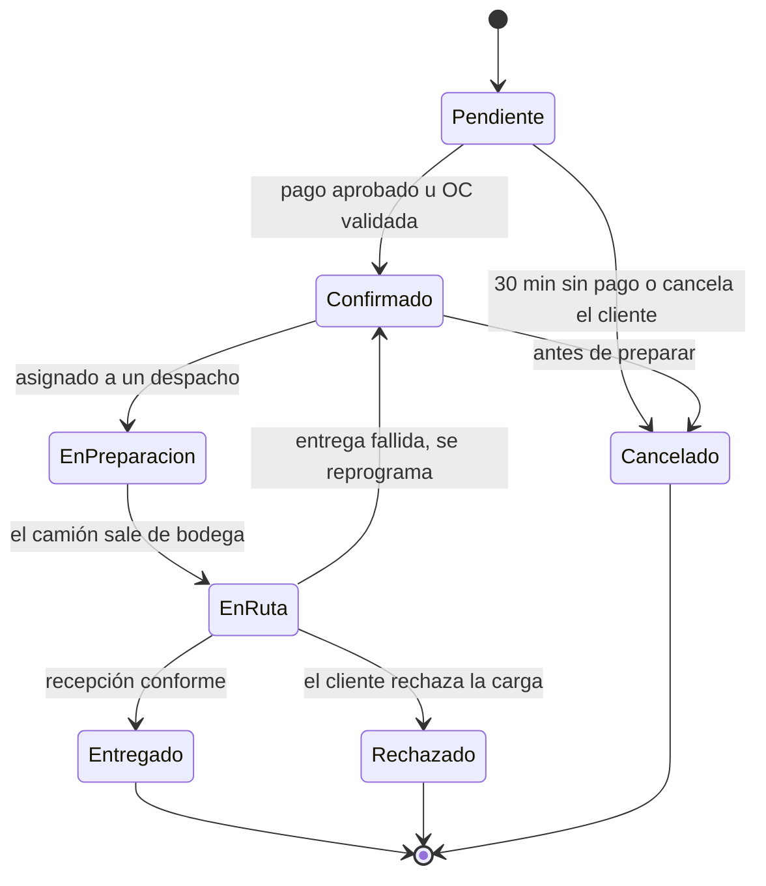

# Reglas de negocio

Perfiles, reglas y ciclos de vida que el portal y el CRM deben respetar. Las tareas citan estas reglas por su identificador (`RN-xx`). Los montos y plazos marcados como *supuesto* son valores razonables para el prototipo y viven en configuración, no en el código.

## 1. Perfiles y canales

Cada persona entra con su propio usuario y un rol. El rol define el canal, lo que puede hacer y qué datos ve.

| Perfil | Canal | Qué puede hacer | Qué datos ve |
| --- | --- | --- | --- |
| Cliente B2C | Portal | Registrarse, comprar con pago en línea, seguir sus pedidos, consultar al asistente IA, reportar problemas | Catálogo con precio público y solo sus pedidos |
| Cliente B2B | Portal | Solicitar cuenta de empresa, comprar con orden de compra, repetir pedidos, gestionar varios puntos de entrega, seguir sus pedidos | Catálogo con su lista institucional y los pedidos de su empresa |
| Vendedor | CRM | Validar empresas, gestionar oportunidades e interacciones, ingresar pedidos telefónicos, confirmar órdenes de compra, atender tickets | Solo su cartera y las alertas de frío que afectan a esos clientes |
| Despachador | CRM | Armar despachos, asignar camión y conductor, cambiar estados logísticos, resolver alertas de frío | Pedidos confirmados, despachos, telemetría y alertas; no ve la gestión comercial |
| Administrador | CRM | Todo lo anterior, más reasignar carteras y mantener catálogo, listas de precios y usuarios | Toda la información |

## 2. Diferencias entre B2B y B2C

Ambos usan el mismo portal, pero cambia el precio, el pago, las validaciones y el despacho.

| Aspecto | B2C (público general) | B2B (institucional) | Dónde vive en el modelo |
| --- | --- | --- | --- |
| Registro | Correo, nombre y una dirección. Activa de inmediato | RUT, razón social, contacto principal y punto de entrega. Pendiente hasta que un ejecutivo la valide | `cliente`, `tipo_cliente`, `contacto_cliente`, `cliente.estado_cliente` |
| Precio | Lista «Público general» | Lista institucional asignada al validar | `cliente.id_lista_precio`, `detalle_lista_precio` |
| Compra | Pedido mínimo de $20.000 | Pedido mínimo de $150.000 neto; puede repetir pedidos | `carrito`, `item_carrito`, `detalle_pedido` |
| Pago | En línea antes de confirmar (simulado) | Orden de compra con crédito a 30 días, validada por el vendedor | `pago.metodo`, `pago.referencia_externa` |
| Despacho | Una dirección | Varios puntos de entrega, cada uno con su ventana | `direccion_despacho` |
| Seguimiento | Estado de su pedido y asistente IA | Historial de toda la empresa y ejecutivo asignado | `historial_estado_pedido`, `cliente.id_vendedor` |

## 3. Reglas

| ID | Regla | Efecto en el sistema |
| --- | --- | --- |
| RN-01 | **Precio según la lista del cliente.** El precio se toma de la lista asignada al cliente (B2C: «Público general») y se copia al detalle al crear el pedido | `detalle_pedido.precio_unitario_pactado` guarda el precio histórico: si la lista cambia, el pedido no cambia |
| RN-02 | **Validación de empresas.** Una cuenta B2B nace «pendiente de validación»: ve el catálogo con precios de lista, pero no compra hasta que un ejecutivo la valide (objetivo: 1 día hábil, *supuesto*) | Al validar se registran `fecha_validacion`, la lista de precios y el vendedor asignado |
| RN-03 | **Pedido mínimo.** B2C $20.000; B2B $150.000 neto (*supuestos*) | «Confirmar pedido» se habilita solo si se cumple; se valida también en el servidor |
| RN-04 | **Reserva de stock.** Agregar al carrito no reserva. Al crear el pedido «Pendiente» se reserva: 30 min para pagar (B2C) o hasta validar la OC (B2B). Si se cancela, se libera | Disponible para venta = `stock_disponible − stock_reservado`. Carrito sin actividad por 24 h → «abandonado» |
| RN-05 | **Pago.** B2C paga en línea antes de la confirmación (pasarela simulada). B2B compra con orden de compra y crédito a 30 días | `pago.estado` decide la transición Pendiente → Confirmado |
| RN-06 | **Fecha y ventana de entrega.** Fecha solicitada desde el siguiente día hábil. La ventana viene del punto de entrega | `pedido.fecha_entrega_solicitada`; `direccion_despacho.ventana_inicio` y `ventana_fin` |
| RN-07 | **Cadena de frío.** Un despacho agrupa solo productos del mismo rango de conservación (el camión tiene una sola cámara). El umbral de alerta del viaje es el rango más exigente de su carga | Una lectura fuera de rango marca `alerta_ruptura_frio = true` y crea un registro en `alerta` con los pedidos afectados |
| RN-08 | **Canal único de pedidos.** Un pedido solo nace en el portal o en el CRM. Si un cliente llama, el vendedor lo ingresa en el CRM; correo y WhatsApp no son canales válidos | `pedido.canal` (`web`, `telefono`, `crm`) y `pedido.id_vendedor_registra` |
| RN-09 | **Historial en lugar de sobrescritura.** Todo cambio de estado de un pedido o de etapa de una oportunidad se registra con fecha, usuario y comentario | `historial_estado_pedido` e `historial_etapa` alimentan las métricas de BI |
| RN-10 | **Alcance de la cartera.** El vendedor ve y edita solo sus clientes; el administrador ve a todo el equipo y puede reasignar | Filtro por `cliente.id_vendedor` según el rol, aplicado en el servidor |
| RN-11 | **Asistente IA.** Responde consultas de estado y catálogo, y clasifica tickets por categoría y prioridad. No se envían RUT ni nombres a la API externa. Si la API no responde, el ticket queda para clasificación manual | `ticket.categoria`, `ticket.prioridad`, `ticket.clasificado_por_ia` |

Otros supuestos configurables: una oportunidad se considera «sin actividad» tras 15 días sin interacciones; la conversión del panel se calcula sobre los últimos 90 días.

## 4. Ciclo de vida del pedido

| De → A | Quién | Condición o disparador | Qué se registra |
| --- | --- | --- | --- |
| Inicio → Pendiente | Cliente (web) o vendedor (CRM) | Hay stock y se cumple el pedido mínimo | `pedido`, `detalle_pedido`, `inventario.stock_reservado` |
| Pendiente → Confirmado | Sistema (B2C) o vendedor (B2B) | Pago en línea aprobado, u orden de compra y crédito validados | `pago`, `historial_estado_pedido` |
| Pendiente → Cancelado | Sistema o cliente | 30 minutos sin pago (B2C) o cancelación del cliente | Se libera `stock_reservado` |
| Confirmado → En preparación | Despachador | El pedido se asignó a un despacho | `despacho_pedido` |
| Confirmado → Cancelado | Cliente o vendedor | Solo antes de que empiece la preparación | Se libera `stock_reservado` |
| En preparación → En ruta | Despachador | El camión asignado sale de bodega | `despacho.salida_real` |
| En ruta → Entregado | Despachador | Recepción conforme del cliente | `despacho_pedido.fecha_entrega`, `movimiento_inventario` (salida) |
| En ruta → Rechazado | Despachador | El cliente rechaza la carga (por ejemplo, fuera de temperatura) | `despacho_pedido.motivo_falla`, `ticket` |
| En ruta → Confirmado | Despachador | Entrega fallida: se reprograma en un nuevo despacho | `despacho_pedido.motivo_falla` |

Cualquier otra transición es inválida y debe rechazarse. Toda transición escribe una fila en `historial_estado_pedido`.

## 5. Ciclo de vida de la oportunidad

| De → A | Quién | Condición o disparador | Qué se registra |
| --- | --- | --- | --- |
| Inicio → Prospecto nuevo | Sistema o vendedor | Registro web de una empresa, o contacto ingresado por el vendedor | `oportunidad.origen` |
| Prospecto nuevo → Contactado | Vendedor | Hay al menos una interacción registrada | `historial_etapa` |
| Contactado → Calificado | Vendedor | Tipo de cliente y monto estimado definidos | `historial_etapa` |
| Calificado → Propuesta | Vendedor | Cliente validado y con lista de precios asignada | `historial_etapa` |
| Propuesta → Negociación | Vendedor | El cliente respondió la propuesta (interacción) | `historial_etapa` |
| Propuesta o Negociación → Ganado | Sistema o vendedor | Existe un pedido vinculado a la oportunidad | `pedido.id_oportunidad`, `fecha_cierre` |
| Cualquier etapa abierta → Perdido | Vendedor | Se ingresa el motivo de pérdida (obligatorio) | `motivo_perdida`, `fecha_cierre` |
| Ganado o Perdido → otra etapa | No permitido | Una oportunidad cerrada no se reabre: se crea una nueva | — |

## 6. Cómo se relacionan ambos ciclos

Una oportunidad es la relación comercial; un pedido es una compra concreta. Una oportunidad ganada puede generar varios pedidos, y muchos pedidos no pasan por una oportunidad.

- **Registro web de una empresa:** crea el cliente en estado pendiente y una oportunidad «Prospecto nuevo» con origen `portal`, asignada a un vendedor. Ningún prospecto digital queda sin seguimiento.
- **Pedido B2C:** no crea oportunidad (`pedido.id_oportunidad` nulo). Igual cuenta en ventas por canal.
- **Pedido B2B con oportunidad en «Propuesta» o «Negociación»:** el sistema vincula el pedido y mueve la oportunidad a «Ganado», registrando el cambio con el usuario `sistema`. El vendedor puede deshacer el vínculo.
- **Recompra B2B sin oportunidad abierta:** venta recurrente; no crea oportunidad, para no inflar la conversión.
- **Pedido rechazado o reclamo:** el ticket aparece en la ficha del cliente y en el panel del vendedor.

## 7. Indicadores que el sistema debe poder calcular

| Indicador | Fórmula | Fuente |
| --- | --- | --- |
| Tasa de conversión | Oportunidades ganadas ÷ creadas | `oportunidad`, `historial_etapa` |
| Pedidos por canal | Conteo y monto por `pedido.canal` | `pedido`, `detalle_pedido` |
| Tiempo de ciclo del pedido | De «Pendiente» a «Confirmado» | `historial_estado_pedido` |
| % de pedidos con reclamo | Pedidos con ticket ÷ pedidos | `ticket`, `pedido` |
| % de entregas fallidas | Paradas fallidas o rechazadas ÷ paradas | `despacho_pedido` |
| Minutos hasta resolver una ruptura | `fecha_resolucion − fecha_hora` de la lectura | `alerta`, `telemetria` |
| Pedidos afectados por rupturas de frío | Pedidos en despachos con alerta | `alerta` → `telemetria` → `despacho` → `despacho_pedido` |
