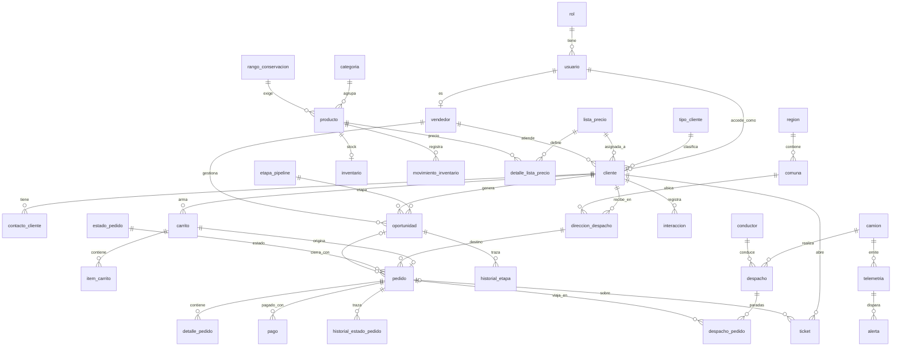

# Modelo de datos

Modelo relacional en Tercera Forma Normal para PostgreSQL 16. **34 tablas** en cinco dominios, transcritas del MER del informe de diseño. Es la referencia para las migraciones de Laravel, el simulador IoT y las consultas de BI.

## Convenciones

- Nombres en español, `snake_case`, minúscula y singular.
- `PK` clave primaria, `FK` clave foránea, `UK` valor único. Dos columnas `PK` forman una clave compuesta.
- Un tipo terminado en `?` admite nulo; el resto es `NOT NULL`. En total 44 columnas admiten nulo.
- Las PK `INT`/`BIGINT` son autogeneradas (`GENERATED ALWAYS AS IDENTITY`), salvo `camion.camion_id`, que es un código de texto.
- Dinero en `NUMERIC` (pesos chilenos), nunca punto flotante. Fechas con hora en `TIMESTAMPTZ`.
- Estados como catálogo (`estado_pedido`, `etapa_pipeline`) o lista cerrada con `CHECK`, nunca texto libre.
- Los campos marcados **[Exigido]** son los parámetros de telemetría que pide el enunciado y no se renombran.

> Las listas de valores, las reglas `CHECK` y los valores por defecto se confirmaron contra el diccionario de datos del informe (Anexo A) el 2026-11-10, al escribir las migraciones de T-003. Las dos desviaciones deliberadas respecto del Anexo están señaladas: los nombres de rol y el valor `sin_clasificar` de `ticket.categoria`.
>
> Este documento y las migraciones de `apps/web/database/migrations` deben coincidir; el test `EsquemaCoincideConDataModelTest` lo comprueba columna por columna.

## Resumen por dominio

| Dominio | Tablas | Qué resuelve |
| --- | --- | --- |
| Clientes y accesos (10) | `region`, `comuna`, `rol`, `usuario`, `tipo_cliente`, `lista_precio`, `vendedor`, `cliente`, `contacto_cliente`, `direccion_despacho` | Quién es el cliente, cómo accede y a dónde se le despacha |
| Catálogo e inventario (6) | `categoria`, `rango_conservacion`, `producto`, `detalle_lista_precio`, `inventario`, `movimiento_inventario` | Qué se vende, a qué precio según el cliente, qué frío exige y cuánto stock hay |
| Ventas (7) | `carrito`, `item_carrito`, `estado_pedido`, `pedido`, `detalle_pedido`, `historial_estado_pedido`, `pago` | Carrito, pedido, precio pactado, estados y pagos |
| CRM comercial (5) | `etapa_pipeline`, `oportunidad`, `historial_etapa`, `interaccion`, `ticket` | Pipeline, oportunidades, interacciones y tickets |
| Logística e IoT (6) | `camion`, `conductor`, `despacho`, `despacho_pedido`, `telemetria`, `alerta` | Flota, despachos, telemetría y alertas de frío |

## Criterios de diseño

1. **Una sola fuente de verdad.** El inventario es un único registro por producto, auditado por una bitácora de movimientos.
2. **Cliente unificado.** B2B y B2C son la misma entidad, diferenciada por `tipo_cliente` y `lista_precio`. Un prospecto es un cliente en estado prospecto, así todo pedido web queda enlazado al CRM sin duplicar datos.
3. **Trazabilidad de la cadena de frío.** Cada producto declara su rango de conservación; el umbral de alerta de un viaje se deriva de la carga, y la alerta se cruza con los pedidos y clientes afectados.
4. **Historial en lugar de sobrescritura.** Los cambios de estado y de etapa quedan registrados con fecha y responsable.
5. **Integridad declarativa.** PK, FK, `UNIQUE` y `CHECK` en la base, no solo en la aplicación.

## Relaciones principales

Nótese que `pedido` no tiene `id_cliente`: el cliente se obtiene por `pedido → direccion_despacho → cliente` (resultado de la 3FN).

---

## 1. Clientes y accesos

### `region`
| Columna | Tipo | Clave | Descripción |
| --- | --- | --- | --- |
| `id_region` | INT | PK | |
| `nombre` | VARCHAR(60) | UK | |

### `comuna`
| Columna | Tipo | Clave | Descripción |
| --- | --- | --- | --- |
| `id_comuna` | INT | PK | |
| `id_region` | INT | FK → `region` | |
| `nombre` | VARCHAR(80) | | Único dentro de su región: `UNIQUE (id_region, nombre)` |

### `rol`
| Columna | Tipo | Clave | Descripción |
| --- | --- | --- | --- |
| `id_rol` | INT | PK | |
| `nombre` | VARCHAR(30) | UK | `administrador`, `vendedor`, `despachador`, `cliente_b2b`, `cliente_b2c`. *Desviación del Anexo A* (que lista `admin`, `vendedor`, `cliente`, `bodega`, `despachador`): se mantienen estos cinco porque la matriz de permisos de `BUSINESS_RULES.md` se construyó sobre ellos y el Anexo no define reglas para «bodega» |
| `descripcion` | VARCHAR(150)? | | |

### `usuario`
| Columna | Tipo | Clave | Descripción |
| --- | --- | --- | --- |
| `id_usuario` | INT | PK | |
| `id_rol` | INT | FK → `rol` | Un rol por usuario |
| `email` | VARCHAR(120) | UK | Identificador de acceso |
| `password_hash` | VARCHAR(255) | | Hash (bcrypt/argon2), nunca texto plano |
| `activo` | BOOLEAN | | Desactivar revoca el acceso sin borrar historial |
| `ultimo_acceso` | TIMESTAMPTZ? | | Nulo hasta el primer inicio de sesión |
| `creado_en` | TIMESTAMPTZ | | |

Existe un usuario técnico `sistema` (sin acceso interactivo) para registrar cambios automáticos en los historiales.

### `tipo_cliente`
| Columna | Tipo | Clave | Descripción |
| --- | --- | --- | --- |
| `id_tipo_cliente` | INT | PK | |
| `codigo` | VARCHAR(3) | UK | `B2B`, `B2C` |
| `nombre` | VARCHAR(60) | | |

### `lista_precio`
| Columna | Tipo | Clave | Descripción |
| --- | --- | --- | --- |
| `id_lista_precio` | INT | PK | |
| `nombre` | VARCHAR(80) | UK | Incluye «Público general» (B2C) y listas institucionales |
| `vigente_desde` | DATE | | |
| `vigente_hasta` | DATE? | | Nulo = sin fecha de término |
| `activa` | BOOLEAN | | |

### `vendedor`
| Columna | Tipo | Clave | Descripción |
| --- | --- | --- | --- |
| `id_vendedor` | INT | PK | |
| `id_usuario` | INT | FK, UK → `usuario` | Un vendedor es exactamente un usuario |
| `nombre` | VARCHAR(100) | | |
| `telefono` | VARCHAR(20)? | | Teléfono corporativo |
| `activo` | BOOLEAN | | |

### `cliente`
| Columna | Tipo | Clave | Descripción |
| --- | --- | --- | --- |
| `id_cliente` | INT | PK | |
| `id_usuario` | INT? | FK, UK → `usuario` | Nulo: un prospecto aún no tiene cuenta |
| `id_tipo_cliente` | INT | FK → `tipo_cliente` | |
| `id_lista_precio` | INT | FK → `lista_precio` | Por defecto «Público general» hasta la validación |
| `id_vendedor` | INT? | FK → `vendedor` | Ejecutivo asignado; define el alcance de cartera (RN-10) |
| `rut` | VARCHAR(12)? | UK | Validado con dígito verificador; obligatorio para B2B |
| `nombre_razon_social` | VARCHAR(150) | | |
| `estado_cliente` | VARCHAR(25) | | `prospecto`, `pendiente_validacion`, `activo`, `inactivo`. B2B queda en `pendiente_validacion` hasta su aprobación comercial |
| `fecha_registro` | TIMESTAMPTZ | | |
| `fecha_validacion` | TIMESTAMPTZ? | | Se llena al validar una empresa (RN-02) |

### `contacto_cliente`
| Columna | Tipo | Clave | Descripción |
| --- | --- | --- | --- |
| `id_contacto` | INT | PK | |
| `id_cliente` | INT | FK → `cliente` | |
| `nombre` | VARCHAR(100) | | |
| `cargo` | VARCHAR(80)? | | |
| `email` | VARCHAR(120) | | |
| `telefono` | VARCHAR(20)? | | |
| `es_principal` | BOOLEAN | | A lo más un contacto principal por cliente (índice único parcial) |

### `direccion_despacho`
| Columna | Tipo | Clave | Descripción |
| --- | --- | --- | --- |
| `id_direccion` | INT | PK | |
| `id_cliente` | INT | FK → `cliente` | |
| `id_comuna` | INT | FK → `comuna` | |
| `alias` | VARCHAR(60) | | Ej.: «Bodega central», «Casino» |
| `calle` | VARCHAR(150) | | |
| `referencia` | VARCHAR(200)? | | |
| `lat` | DOUBLE PRECISION? | | `CHECK` entre -90 y 90 |
| `long` | DOUBLE PRECISION? | | `CHECK` entre -180 y 180 |
| `ventana_inicio` | TIME? | | Ventana de recepción (RN-06) |
| `ventana_fin` | TIME? | | `CHECK ventana_fin > ventana_inicio` |
| `activa` | BOOLEAN | | Solo las activas se ofrecen en el checkout |

---

## 2. Catálogo e inventario

### `categoria`
| Columna | Tipo | Clave | Descripción |
| --- | --- | --- | --- |
| `id_categoria` | INT | PK | |
| `nombre` | VARCHAR(60) | UK | Ej.: Cárnicos, Lácteos, Congelados |
| `descripcion` | VARCHAR(200)? | | |

### `rango_conservacion`
| Columna | Tipo | Clave | Descripción |
| --- | --- | --- | --- |
| `id_rango` | INT | PK | |
| `nombre` | VARCHAR(40) | UK | Ej.: Refrigerado, Congelado |
| `temp_min_c` | NUMERIC(4,1) | | °C |
| `temp_max_c` | NUMERIC(4,1) | | °C; `CHECK temp_max_c > temp_min_c` |

### `producto`
| Columna | Tipo | Clave | Descripción |
| --- | --- | --- | --- |
| `id_producto` | INT | PK | |
| `id_categoria` | INT | FK → `categoria` | |
| `id_rango` | INT | FK → `rango_conservacion` | Frío que exige el producto (RN-07) |
| `sku` | VARCHAR(30) | UK | |
| `nombre` | VARCHAR(120) | | |
| `descripcion` | TEXT? | | |
| `unidad_medida` | VARCHAR(10) | | `kg`, `un`, `caja` |
| `activo` | BOOLEAN | | |

### `detalle_lista_precio`
| Columna | Tipo | Clave | Descripción |
| --- | --- | --- | --- |
| `id_lista_precio` | INT | PK, FK → `lista_precio` | |
| `id_producto` | INT | PK, FK → `producto` | |
| `precio_unitario` | NUMERIC(12,2) | | En CLP; `CHECK >= 0` |

### `inventario`
| Columna | Tipo | Clave | Descripción |
| --- | --- | --- | --- |
| `id_producto` | INT | PK, FK → `producto` | Relación 1:1 con producto |
| `stock_disponible` | NUMERIC(12,2) | | `CHECK >= 0` |
| `stock_reservado` | NUMERIC(12,2) | | `CHECK >= 0` y `<= stock_disponible` |
| `actualizado_en` | TIMESTAMPTZ | | |

**Disponible para venta = `stock_disponible − stock_reservado`** (RN-04).

### `movimiento_inventario`
| Columna | Tipo | Clave | Descripción |
| --- | --- | --- | --- |
| `id_movimiento` | BIGINT | PK | |
| `id_producto` | INT | FK → `producto` | |
| `id_pedido` | INT? | FK → `pedido` | Nulo en ingresos y ajustes |
| `id_usuario` | INT | FK → `usuario` | Responsable (o `sistema`) |
| `tipo` | VARCHAR(15) | | `ingreso`, `reserva`, `liberacion`, `salida`, `ajuste`, `merma` |
| `cantidad` | NUMERIC(12,2) | | Positiva o negativa según el tipo; `CHECK <> 0`. Convención: `ingreso` suma y `salida`/`merma` restan a `stock_disponible`; `reserva` suma y `liberacion` resta a `stock_reservado`; `ajuste` corrige `stock_disponible` con su signo |
| `fecha_hora` | TIMESTAMPTZ | | |

Bitácora de solo inserción.

---

## 3. Ventas

### `carrito`
| Columna | Tipo | Clave | Descripción |
| --- | --- | --- | --- |
| `id_carrito` | INT | PK | |
| `id_cliente` | INT | FK → `cliente` | |
| `estado` | VARCHAR(15) | | `activo`, `convertido`, `abandonado`. Un solo carrito `activo` por cliente (índice único parcial); `convertido` = ya generó un pedido |
| `creado_en` | TIMESTAMPTZ | | |
| `actualizado_en` | TIMESTAMPTZ | | Sin actividad por 24 h → `abandonado` |

### `item_carrito`
| Columna | Tipo | Clave | Descripción |
| --- | --- | --- | --- |
| `id_carrito` | INT | PK, FK → `carrito` | |
| `id_producto` | INT | PK, FK → `producto` | |
| `cantidad` | NUMERIC(12,2) | | `CHECK > 0` |

El carrito no guarda precio: siempre se calcula con la lista vigente del cliente.

### `estado_pedido`
| Columna | Tipo | Clave | Descripción |
| --- | --- | --- | --- |
| `id_estado_pedido` | INT | PK | |
| `nombre` | VARCHAR(30) | UK | |
| `orden` | SMALLINT | UK | |
| `es_final` | BOOLEAN | | |

Valores: `Pendiente` (1), `Confirmado` (2), `En preparación` (3), `En ruta` (4), `Entregado` (5, final), `Rechazado` (6, final), `Cancelado` (7, final).

### `pedido`
| Columna | Tipo | Clave | Descripción |
| --- | --- | --- | --- |
| `id_pedido` | INT | PK | |
| `id_direccion` | INT | FK → `direccion_despacho` | De aquí se obtiene el cliente |
| `id_estado_pedido` | INT | FK → `estado_pedido` | Estado actual |
| `id_carrito` | INT? | FK, UK → `carrito` | Nulo si no nació de un carrito |
| `id_oportunidad` | INT? | FK → `oportunidad` | Nulo en compras B2C y recompras |
| `id_vendedor_registra` | INT? | FK → `vendedor` | Quién lo ingresó si fue por CRM o teléfono (RN-08) |
| `canal` | VARCHAR(10) | | `portal`, `crm` (RN-08: un pedido telefónico lo ingresa el vendedor en el CRM) |
| `fecha_pedido` | TIMESTAMPTZ | | |
| `fecha_entrega_solicitada` | DATE? | | Desde el siguiente día hábil (RN-06) |
| `observaciones` | VARCHAR(300)? | | |

No hay columna de total: se calcula desde `detalle_pedido`.

### `detalle_pedido`
| Columna | Tipo | Clave | Descripción |
| --- | --- | --- | --- |
| `id_pedido` | INT | PK, FK → `pedido` | |
| `id_producto` | INT | PK, FK → `producto` | |
| `cantidad` | NUMERIC(12,2) | | `CHECK > 0` |
| `precio_unitario_pactado` | NUMERIC(12,2) | | Copia deliberada del precio al comprar (RN-01): si la lista cambia, el pedido no. `CHECK >= 0` |

### `historial_estado_pedido`
| Columna | Tipo | Clave | Descripción |
| --- | --- | --- | --- |
| `id_historial` | BIGINT | PK | |
| `id_pedido` | INT | FK → `pedido` | |
| `id_estado_pedido` | INT | FK → `estado_pedido` | Estado al que pasó |
| `id_usuario` | INT? | FK → `usuario` | Quién hizo el cambio |
| `fecha_hora` | TIMESTAMPTZ | | |
| `comentario` | VARCHAR(300)? | | |

### `pago`
| Columna | Tipo | Clave | Descripción |
| --- | --- | --- | --- |
| `id_pago` | INT | PK | |
| `id_pedido` | INT | FK → `pedido` | |
| `monto` | NUMERIC(12,2) | | `CHECK > 0` |
| `metodo` | VARCHAR(15) | | `tarjeta`, `transferencia`, `credito_30d`, `efectivo`. B2C paga con `tarjeta` o `transferencia`; `credito_30d` (orden de compra) solo B2B (RN-05) |
| `estado` | VARCHAR(15) | | `pendiente`, `aprobado`, `rechazado`, `reembolsado` |
| `referencia_externa` | VARCHAR(80)? | | N.º de transacción simulada o de orden de compra |
| `fecha_hora` | TIMESTAMPTZ | | |

---

## 4. CRM comercial

### `etapa_pipeline`
| Columna | Tipo | Clave | Descripción |
| --- | --- | --- | --- |
| `id_etapa` | INT | PK | |
| `nombre` | VARCHAR(40) | UK | |
| `orden` | SMALLINT | UK | |
| `es_cierre` | BOOLEAN | | |
| `es_ganada` | BOOLEAN | | `CHECK`: solo puede ser verdadera si `es_cierre` |

Valores: `Prospecto nuevo` (1), `Contactado` (2), `Calificado` (3), `Propuesta` (4), `Negociación` (5), `Ganado` (6, cierre, ganada), `Perdido` (7, cierre).

### `oportunidad`
| Columna | Tipo | Clave | Descripción |
| --- | --- | --- | --- |
| `id_oportunidad` | INT | PK | |
| `id_cliente` | INT | FK → `cliente` | |
| `id_vendedor` | INT | FK → `vendedor` | |
| `id_etapa` | INT | FK → `etapa_pipeline` | Etapa actual |
| `titulo` | VARCHAR(150) | | |
| `origen` | VARCHAR(15) | | `portal`, `vendedor`, `telefono`, `referido` |
| `monto_estimado` | NUMERIC(14,2)? | | Requerido para pasar a «Calificado» |
| `fecha_creacion` | TIMESTAMPTZ | | |
| `fecha_cierre_estimada` | DATE? | | |
| `fecha_cierre` | TIMESTAMPTZ? | | Se llena al pasar a Ganado o Perdido |
| `motivo_perdida` | VARCHAR(200)? | | Obligatorio al pasar a «Perdido» |

### `historial_etapa`
| Columna | Tipo | Clave | Descripción |
| --- | --- | --- | --- |
| `id_historial` | BIGINT | PK | |
| `id_oportunidad` | INT | FK → `oportunidad` | |
| `id_etapa` | INT | FK → `etapa_pipeline` | Etapa a la que pasó |
| `id_usuario` | INT? | FK → `usuario` | |
| `fecha_hora` | TIMESTAMPTZ | | |
| `comentario` | VARCHAR(300)? | | |

### `interaccion`
| Columna | Tipo | Clave | Descripción |
| --- | --- | --- | --- |
| `id_interaccion` | BIGINT | PK | |
| `id_cliente` | INT | FK → `cliente` | |
| `id_vendedor` | INT | FK → `vendedor` | |
| `id_oportunidad` | INT? | FK → `oportunidad` | Opcional |
| `tipo` | VARCHAR(15) | | `llamada`, `correo`, `reunion`, `visita`, `mensaje` |
| `resumen` | TEXT | | |
| `fecha_hora` | TIMESTAMPTZ | | |

### `ticket`
| Columna | Tipo | Clave | Descripción |
| --- | --- | --- | --- |
| `id_ticket` | INT | PK | |
| `id_cliente` | INT | FK → `cliente` | |
| `id_pedido` | INT? | FK → `pedido` | Si el requerimiento es sobre un pedido |
| `id_vendedor` | INT? | FK → `vendedor` | Quién lo atiende |
| `asunto` | VARCHAR(150) | | |
| `descripcion` | TEXT | | |
| `categoria` | VARCHAR(15) | | `sin_clasificar`, `consulta`, `reclamo`, `cambio_pedido`, `cotizacion`, `otro`. *Desviación del Anexo A:* se agrega `sin_clasificar` (valor por defecto) para distinguir un ticket pendiente de clasificar de una consulta real (T-018, T-021) |
| `prioridad` | VARCHAR(10) | | `baja`, `media`, `alta` |
| `estado` | VARCHAR(15) | | `abierto`, `en_proceso`, `resuelto`, `cerrado` |
| `clasificado_por_ia` | BOOLEAN | | Falso si se clasificó a mano (RN-11) |
| `creado_en` | TIMESTAMPTZ | | |
| `cerrado_en` | TIMESTAMPTZ? | | |

---

## 5. Logística e IoT

### `camion`
| Columna | Tipo | Clave | Descripción |
| --- | --- | --- | --- |
| `camion_id` | VARCHAR(20) | PK | **[Exigido]** Identificador de la unidad, ej. `CAM-001` |
| `patente` | VARCHAR(10) | UK | |
| `capacidad_kg` | INT | | `CHECK > 0` |
| `activo` | BOOLEAN | | |

### `conductor`
| Columna | Tipo | Clave | Descripción |
| --- | --- | --- | --- |
| `id_conductor` | INT | PK | |
| `rut` | VARCHAR(12) | UK | Dato personal |
| `nombre` | VARCHAR(100) | | Dato personal; nunca se muestra al cliente |
| `telefono` | VARCHAR(20)? | | |
| `activo` | BOOLEAN | | |

### `despacho`
| Columna | Tipo | Clave | Descripción |
| --- | --- | --- | --- |
| `id_despacho` | INT | PK | |
| `camion_id` | VARCHAR(20) | FK → `camion` | |
| `id_conductor` | INT | FK → `conductor` | |
| `estado` | VARCHAR(15) | | `programado`, `en_ruta`, `finalizado`, `cancelado` |
| `fecha_programada` | DATE | | |
| `salida_real` | TIMESTAMPTZ? | | Al salir de bodega; lleva los pedidos a «En ruta» |
| `llegada_real` | TIMESTAMPTZ? | | |

### `despacho_pedido`
| Columna | Tipo | Clave | Descripción |
| --- | --- | --- | --- |
| `id_despacho` | INT | PK, FK → `despacho` | |
| `id_pedido` | INT | PK, FK → `pedido` | |
| `orden_parada` | SMALLINT | | Secuencia de la ruta; `CHECK > 0` |
| `estado_entrega` | VARCHAR(25) | | `pendiente`, `entregado`, `fallido`, `rechazado_temperatura` |
| `fecha_entrega` | TIMESTAMPTZ? | | |
| `motivo_falla` | VARCHAR(200)? | | Obligatorio si fue rechazado o fallido |

Un pedido puede aparecer en más de un despacho (reprogramación tras una entrega fallida).

### `telemetria`
| Columna | Tipo | Clave | Descripción |
| --- | --- | --- | --- |
| `id_telemetria` | BIGINT | PK | |
| `camion_id` | VARCHAR(20) | FK → `camion` | **[Exigido]** |
| `fecha_hora` | TIMESTAMPTZ | | Momento de la lectura |
| `temp_camara` | REAL | | **[Exigido]** °C en la cámara de frío; `CHECK` entre -60 y 60 |
| `lat` | DOUBLE PRECISION | | **[Exigido]** `CHECK` entre -90 y 90 |
| `long` | DOUBLE PRECISION | | **[Exigido]** `CHECK` entre -180 y 180 |
| `combustible_pct` | SMALLINT | | **[Exigido]** `CHECK` entre 0 y 100 |
| `alerta_ruptura_frio` | BOOLEAN | | **[Exigido]** Verdadero si excede el rango crítico |

Índice `(camion_id, fecha_hora DESC)`. Sin particionar ([ADR-0017](ADR/0017-telemetria-sin-particionar.md)). `long` es palabra reservada en algunos contextos: citar como `"long"` en SQL crudo si hiciera falta.

### `alerta`
| Columna | Tipo | Clave | Descripción |
| --- | --- | --- | --- |
| `id_alerta` | BIGINT | PK | |
| `id_telemetria` | BIGINT | FK → `telemetria` | Lectura que la originó |
| `id_usuario_resuelve` | INT? | FK → `usuario` | Despachador que la cerró |
| `tipo` | VARCHAR(20) | | `ruptura_frio`, `combustible_bajo` |
| `severidad` | VARCHAR(10) | | `media`, `alta`, `critica` |
| `estado` | VARCHAR(15) | | `abierta`, `reconocida`, `resuelta` |
| `accion_correctiva` | VARCHAR(300)? | | Obligatoria al resolver |
| `fecha_resolucion` | TIMESTAMPTZ? | | |

Los pedidos afectados por una alerta se derivan: `alerta → telemetria → camion → despacho (en ruta) → despacho_pedido → pedido → direccion_despacho → cliente`.

---

## Reglas comunes y valores por defecto

- Todas las PK numéricas son `GENERATED ALWAYS AS IDENTITY`: la base asigna el número y rechaza un valor explícito (los seeders no fijan IDs).
- Las claves foráneas usan `ON DELETE RESTRICT`: nada se borra en cascada, porque los historiales y los pedidos deben conservarse. Las líneas dependientes (`item_carrito`, `detalle_pedido`, `detalle_lista_precio`, `despacho_pedido`) tampoco se borran solas.
- Las listas de valores son `CHECK (columna IN (...))` y aparecen en la columna «Descripción» de cada tabla.
- Valores por defecto (Anexo A):

| Valor | Columnas |
| --- | --- |
| `now()` | `usuario.creado_en`, `cliente.fecha_registro`, `inventario.actualizado_en`, `movimiento_inventario.fecha_hora`, `carrito.creado_en`, `carrito.actualizado_en`, `pedido.fecha_pedido`, `historial_estado_pedido.fecha_hora`, `pago.fecha_hora`, `oportunidad.fecha_creacion`, `historial_etapa.fecha_hora`, `interaccion.fecha_hora`, `ticket.creado_en`, `telemetria.fecha_hora` |
| `CURRENT_DATE` | `lista_precio.vigente_desde` |
| `TRUE` | `usuario.activo`, `lista_precio.activa`, `vendedor.activo`, `direccion_despacho.activa`, `producto.activo`, `camion.activo`, `conductor.activo` |
| `FALSE` | `contacto_cliente.es_principal`, `estado_pedido.es_final`, `etapa_pipeline.es_cierre`, `etapa_pipeline.es_ganada`, `ticket.clasificado_por_ia`, `telemetria.alerta_ruptura_frio` |
| `0` | `inventario.stock_disponible`, `inventario.stock_reservado` |
| Texto | `cliente.estado_cliente` = `prospecto`, `carrito.estado` = `activo`, `pago.estado` = `pendiente`, `ticket.categoria` = `sin_clasificar`, `ticket.prioridad` = `media`, `ticket.estado` = `abierto`, `despacho.estado` = `programado`, `despacho_pedido.estado_entrega` = `pendiente`, `alerta.estado` = `abierta` |

## Tablas del framework

Además de las 34 tablas de negocio, Laravel crea sus propias tablas de soporte (`sessions`, `cache`, `cache_locks`, `jobs`, `job_batches`, `failed_jobs`, `migrations`). Conservan su nombre en inglés y no forman parte del MER. Las tablas `users` y `password_reset_tokens` del esqueleto de Laravel se eliminaron: la autenticación usa `usuario` (T-006). PostGIS agrega `spatial_ref_sys`. Grafana usa una base aparte (`grafana`) dentro de la misma instancia.

## Roles de base de datos

| Rol | Permisos | Lo usa |
| --- | --- | --- |
| `app_rw` | Lectura y escritura sobre el esquema de negocio; sin `UPDATE`/`DELETE` en los historiales y sin escribir `telemetria` | Laravel (web y worker) |
| `iot_writer` | `INSERT` en `telemetria` y `alerta`; `SELECT` en la vista `iot_umbral_camion` | Simulador IoT |
| `bi_reader` | `SELECT` sobre las vistas `bi_*` | Grafana |
| `grafana_rw` | Dueño de la base aparte `grafana`; sin acceso a la base de negocio | Grafana (estado interno) |

Se crean con [`db/roles.sql`](../db/roles.sql) usando el usuario maestro, que es además el dueño del esquema y corre las migraciones (`php artisan migrate --database=pgsql_admin`); `app_rw` no puede crear ni borrar tablas. Detalle y orden de aplicación en [`db/README.md`](../db/README.md).

## Puntos abiertos

Decisiones del modelo que hay que cerrar al implementar. Regístralas en un ADR cuando se resuelvan.

1. ~~**Particionamiento de `telemetria` frente a la FK de `alerta`.**~~ *Resuelto (2026-11-10):* no se particiona; índice `(camion_id, fecha_hora DESC)`. Ver [ADR-0017](ADR/0017-telemetria-sin-particionar.md).
2. ~~**Quién calcula el umbral de frío.**~~ *Resuelto (T-005):* vista de solo lectura `iot_umbral_camion (camion_id, activo, temp_min_c, temp_max_c, alerta_ruptura_abierta)` en [`db/vistas_iot.sql`](../db/vistas_iot.sql). El rango es el más exigente de la carga del despacho `en_ruta` del camión (máximo de los mínimos, mínimo de los máximos) y es nulo si no tiene despacho en ruta: el simulador usa entonces su rango por defecto. `alerta_ruptura_abierta` evita repetir la alerta (punto 3).
3. **Varias lecturas fuera de rango seguidas.** Para no crear una alerta cada 30 s, el simulador crea una alerta al iniciar el episodio y no repite mientras haya una alerta abierta de ese camión.
4. **Coordenadas y PostGIS.** El MER guarda `lat`/`long` como columnas numéricas (exigidas por el enunciado). PostGIS queda disponible para consultas espaciales o columnas generadas, sin reemplazar esas columnas.
5. **Conservación de la telemetría.** Al ser potencialmente dato personal (posición de un conductor identificable), definir un plazo de retención (propuesta: 90 días de detalle) y un trabajo de purga.
6. ~~**Listas de valores.**~~ *Resuelto (2026-11-10):* confirmadas contra el Anexo A; ver la nota de convenciones y las dos desviaciones señaladas en `rol` y `ticket`.
