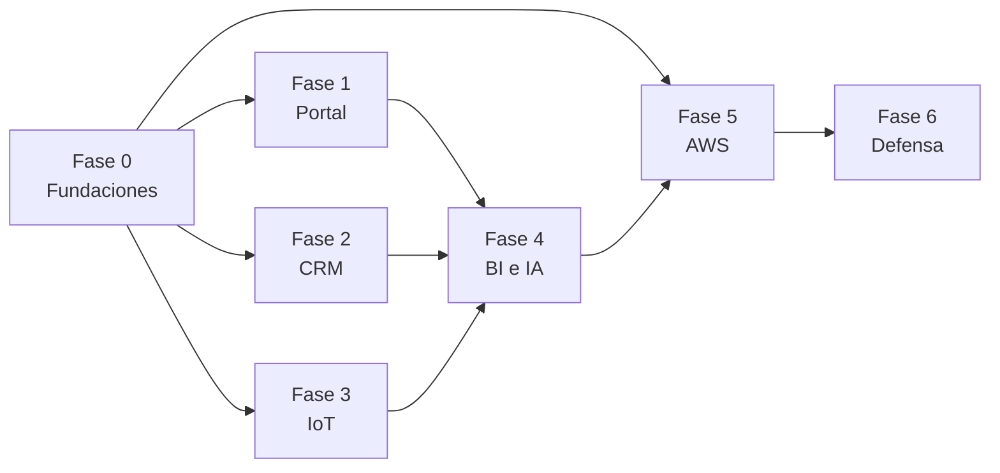

# Roadmap

Plan de construcción del prototipo hasta la defensa del Hito 2. El avance real se lleva en [`tasks/README.md`](../tasks/README.md); este documento explica el orden y las prioridades.

## Hitos

| Hito | Contenido | Estado |
| --- | --- | --- |
| Hito 1 | Diagnóstico, arquitectura cloud, MER en 3FN, canales y flujos de CRM (informe de diseño) | Entregado |
| Hito 2 | Despliegue funcional en AWS Academy: e-commerce con carrito, CRM operativo, simulación IoT con Docker, dashboard de BI e IA | En curso |

## Fases

Las fases 1 a 3 pueden avanzar en paralelo una vez cerrada la fase 0. La fase 5 puede empezar apenas exista T-001, porque la red y la base no dependen del código.

| Fase | Objetivo | Tareas | Dimensión de la pauta |
| --- | --- | --- | --- |
| 0 · Fundaciones | Aplicación base, entorno local, esquema, datos de demostración, accesos | T-001 a T-007 | Base de todas |
| 1 · Portal de ventas | Catálogo, registro B2B/B2C, carrito, checkout y seguimiento | T-008 a T-012 | 2 |
| 2 · CRM | Panel, cartera, pipeline, pedidos, logística y tickets | T-013 a T-018 | 2 |
| 3 · IoT | Simulador de telemetría en contenedores | T-019 | 3 |
| 4 · BI e IA | Dashboard en vivo e integración de IA | T-020 a T-021 | 4 y 5 |
| 5 · Despliegue en AWS | Red, RDS, EC2 web con ALB, nodo IoT, monitoreo | T-022 a T-026 | 1 y 3 |
| 6 · Defensa | Ensayo integral, pruebas de falla y guion de la demo | T-027 | 5 |

## Ruta crítica

Si el tiempo no alcanza para todo, este es el camino más corto que deja las cinco dimensiones de la pauta en «Logrado». Cada paso produce algo demostrable.

| Orden | Tarea | Qué queda demostrable | Dimensión |
| --- | --- | --- | --- |
| 1 | T-001, T-002, T-003, T-004 | Aplicación que arranca contra PostgreSQL con el esquema y datos de demo | — |
| 2 | T-022, T-023 | VPC y RDS operativos en AWS | 1 |
| 3 | T-006 | Inicio de sesión con roles | 2 |
| 4 | T-008, T-010, T-011 | Catálogo con precios B2B/B2C, carrito y generación de órdenes | 2 |
| 5 | T-019 | Contenedores inyectando telemetría y alertas | 3 |
| 6 | T-013, T-014, T-016 | CRM con clientes, prospectos y seguimiento de los pedidos web | 2 |
| 7 | T-020 | Dashboard en vivo que cruza ventas con cadena de frío | 4 |
| 8 | T-021 | Tickets clasificados por una IA gratuita | 5 |
| 9 | T-024, T-025 | Todo corriendo en EC2 detrás del balanceador y en el nodo IoT | 1, 3 |
| 10 | T-027 | Demo ensayada de principio a fin | 5 |

Lo que puede simplificarse sin perder puntaje, en este orden: repetir pedido y direcciones múltiples (parte de T-012), pipeline con arrastrar y soltar (T-015 puede ser un formulario de cambio de etapa), mantenedores de administración (T-007 puede cubrirse con seeders), alarmas de CloudWatch (T-026) y el asistente conversacional (T-021 puede limitarse a la clasificación de tickets).

Lo que **no** conviene recortar: el backend conectado a RDS, el carrito con generación de órdenes, la distinción de precios B2B/B2C, la inyección automática de telemetría desde Docker en EC2, el dashboard conectado en vivo y una llamada real a la API de IA. Son exactamente los puntos que la pauta distingue entre «Logrado» y «Medianamente logrado».

## Relación con la pauta de evaluación

| Dimensión | Qué exige «Logrado» | Tareas que la cubren | Evidencia para la defensa |
| --- | --- | --- | --- |
| 1. Despliegue cloud en AWS Academy | EC2 y RDS funcionales, estables y conectados | T-022, T-023, T-024, T-026 | Consola de AWS, `/health` en verde en el balanceador, aplicación accesible por el DNS del ALB |
| 2. E-commerce y CRM operativo | Carrito, pedidos B2B/B2C y panel de CRM conectados a la base en la nube | T-006 a T-018 | Compra B2C y B2B en vivo; el pedido aparece en el CRM y cambia de estado |
| 3. Simulación IoT con Docker en EC2 | Contenedores que inyectan telemetría automática y estructurada | T-019, T-025 | `docker ps` y `docker logs` en el nodo IoT; filas nuevas en `telemetria` cada 30 s |
| 4. Dashboard de BI | Panel en vivo que cruza ventas con cadena de frío | T-020 | Grafana actualizándose; una alerta de frío aparece junto a los pedidos afectados |
| 5. IA a costo cero y defensa | API pública de IA integrada y demostración solvente | T-021, T-027 | Un ticket nuevo queda clasificado por la IA; recorrido completo sin fallas |

## Guion sugerido para la demostración

Un recorrido que toca las cinco dimensiones en orden natural:

1. Un cliente B2C compra en el portal y paga (pasarela simulada).
2. Una empresa se registra; el vendedor la valida en el CRM y le asigna una lista de precios; la empresa ve precios distintos y compra con orden de compra.
3. El despachador arma un despacho y registra la salida del camión.
4. En el nodo IoT se muestran los contenedores y las lecturas; una ruptura de frío aparece como alerta en el CRM.
5. Grafana muestra las ventas por canal junto a la alerta y los pedidos afectados.
6. El cliente reporta un problema; el ticket aparece clasificado por la IA.
7. Se detiene una EC2 web y el sitio sigue respondiendo.

## Riesgos del plan

| Riesgo | Impacto | Respuesta |
| --- | --- | --- |
| Límites del Learner Lab (Multi-AZ, tipos de instancia, IAM) | El despliegue no calza con el diseño | Verificarlo al inicio de la fase 5; si hay que desviarse, registrar un ADR |
| La sesión del laboratorio caduca y detiene las instancias | La demo no arranca | Contenedores con reinicio automático; ensayar el arranque en frío en T-027 |
| Cuota de la API de IA gratuita | La clasificación falla en vivo | Degradación a clasificación manual; tickets ya clasificados en los datos de demo |
| El esquema de 34 tablas consume el tiempo disponible | Se atrasa todo lo demás | Migrar primero las tablas de la ruta crítica; el resto puede crearse sin interfaz |
| Dos instancias web con estado local | Sesiones perdidas al balancear | Sesiones, caché y colas en la base desde T-001 |
| Créditos del laboratorio | Se agotan antes de la defensa | Detener el laboratorio al terminar cada sesión de trabajo |

## Después del Hito 2

Ideas fuera del alcance evaluado, para una eventual continuación:

- Pasarela de pago real y facturación electrónica.
- Sensores físicos y un gateway de telemetría en lugar del simulador.
- Optimización de rutas con ventanas de entrega.
- Dominio propio con certificado público, WAF y autoescalado.
- Particionamiento mensual y política de retención de la telemetría.
- Portal del conductor para registrar entregas desde el teléfono.
