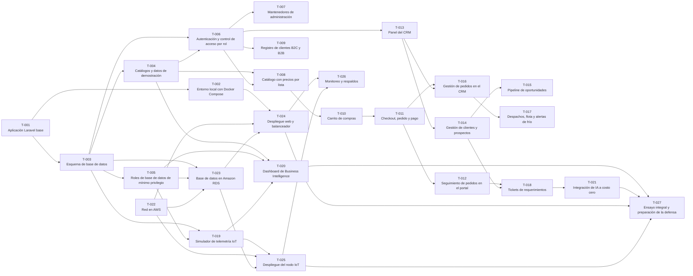

# Tareas

Índice general del trabajo necesario para llegar a la funcionalidad completa del sistema. Cada tarea vive en su propia carpeta con un `README.md` que define objetivo, alcance y criterios de aceptación.

## Cómo usar este índice

1. Elige una tarea `Pendiente` cuyas dependencias estén `Terminada`.
2. Cambia su estado a `En curso` en la tabla.
3. Trabaja según su `README.md` y las reglas de [`AGENTS.md`](../AGENTS.md).
4. Cuando se cumplan todos los criterios de aceptación, cámbiala a `Terminada`.

Estados: `Pendiente` · `En curso` · `Bloqueada` · `Terminada`. Una tarea `Bloqueada` explica el motivo en sus notas.

La columna **RC** marca la ruta crítica: el conjunto mínimo que cubre las cinco dimensiones de la pauta (ver [`docs/ROADMAP.md`](../docs/ROADMAP.md)).

## Fase 0 · Fundaciones

| Tarea | Título | Depende de | Pauta | RC | Estado |
| --- | --- | --- | --- | :-: | --- |
| [T-001](T-001-bootstrap-laravel/README.md) | Aplicación Laravel base | — | 1, 2 | ● | En curso |
| [T-002](T-002-entorno-local-docker/README.md) | Entorno local con Docker Compose | T-001 | 1, 3 | ● | Pendiente |
| [T-003](T-003-esquema-base-de-datos/README.md) | Esquema de base de datos | T-001 | 2 | ● | Pendiente |
| [T-004](T-004-datos-semilla/README.md) | Catálogos y datos de demostración | T-003 | 2, 4 | ● | Pendiente |
| [T-005](T-005-roles-base-de-datos/README.md) | Roles de base de datos de mínimo privilegio | T-003 | 1 |  | Pendiente |
| [T-006](T-006-autenticacion-y-roles/README.md) | Autenticación y control de acceso por rol | T-003, T-004 | 2 | ● | Pendiente |
| [T-007](T-007-mantenedores-administracion/README.md) | Mantenedores de administración | T-006 | 2 |  | Pendiente |

## Fase 1 · Portal de ventas

| Tarea | Título | Depende de | Pauta | RC | Estado |
| --- | --- | --- | --- | :-: | --- |
| [T-008](T-008-catalogo-y-precios/README.md) | Catálogo con precios por lista | T-004, T-006 | 2 | ● | Pendiente |
| [T-009](T-009-registro-de-clientes/README.md) | Registro de clientes B2C y B2B | T-006 | 2 |  | Pendiente |
| [T-010](T-010-carrito/README.md) | Carrito de compras | T-008 | 2 | ● | Pendiente |
| [T-011](T-011-checkout-y-pedido/README.md) | Checkout, pedido y pago | T-010 | 2 | ● | Pendiente |
| [T-012](T-012-seguimiento-de-pedidos/README.md) | Seguimiento de pedidos en el portal | T-011 | 2 |  | Pendiente |

## Fase 2 · CRM

| Tarea | Título | Depende de | Pauta | RC | Estado |
| --- | --- | --- | --- | :-: | --- |
| [T-013](T-013-panel-crm/README.md) | Panel del CRM | T-006 | 2 | ● | Pendiente |
| [T-014](T-014-gestion-de-clientes/README.md) | Gestión de clientes y prospectos | T-013 | 2 | ● | Pendiente |
| [T-015](T-015-pipeline-de-oportunidades/README.md) | Pipeline de oportunidades | T-014 | 2 |  | Pendiente |
| [T-016](T-016-gestion-de-pedidos/README.md) | Gestión de pedidos en el CRM | T-011, T-013 | 2 | ● | Pendiente |
| [T-017](T-017-logistica-y-alertas/README.md) | Despachos, flota y alertas de frío | T-016 | 2, 3 |  | Pendiente |
| [T-018](T-018-tickets/README.md) | Tickets de requerimientos | T-012, T-014 | 2, 5 |  | Pendiente |

## Fase 3 · IoT

| Tarea | Título | Depende de | Pauta | RC | Estado |
| --- | --- | --- | --- | :-: | --- |
| [T-019](T-019-simulador-iot/README.md) | Simulador de telemetría IoT | T-003, T-005 | 3 | ● | Pendiente |

## Fase 4 · BI e IA

| Tarea | Título | Depende de | Pauta | RC | Estado |
| --- | --- | --- | --- | :-: | --- |
| [T-020](T-020-dashboard-bi/README.md) | Dashboard de Business Intelligence | T-004, T-005, T-019 | 4 | ● | Pendiente |
| [T-021](T-021-integracion-ia/README.md) | Integración de IA a costo cero | T-018 | 5 | ● | Pendiente |

## Fase 5 · Despliegue en AWS

| Tarea | Título | Depende de | Pauta | RC | Estado |
| --- | --- | --- | --- | :-: | --- |
| [T-022](T-022-red-aws/README.md) | Red en AWS | — | 1 | ● | Pendiente |
| [T-023](T-023-base-de-datos-rds/README.md) | Base de datos en Amazon RDS | T-003, T-005, T-022 | 1 | ● | Pendiente |
| [T-024](T-024-despliegue-web-y-balanceador/README.md) | Despliegue web y balanceador | T-002, T-022, T-023 | 1, 2 | ● | Pendiente |
| [T-025](T-025-despliegue-nodo-iot/README.md) | Despliegue del nodo IoT | T-019, T-022, T-023 | 3 | ● | Pendiente |
| [T-026](T-026-monitoreo-y-respaldos/README.md) | Monitoreo y respaldos | T-024, T-025 | 1 |  | Pendiente |

## Fase 6 · Defensa

| Tarea | Título | Depende de | Pauta | RC | Estado |
| --- | --- | --- | --- | :-: | --- |
| [T-027](T-027-ensayo-de-defensa/README.md) | Ensayo integral y preparación de la defensa | T-020, T-021, T-024, T-025 | 5 | ● | Pendiente |

## Dependencias

## Crear una tarea nueva

1. Copia [`_plantilla/`](_plantilla/README.md) a `T-0NN-<slug>/` con el siguiente número libre. Los números no se reutilizan.
2. Completa todas las secciones; los criterios de aceptación deben poder verificarse ejecutando algo.
3. Agrégala a la tabla de su fase y, si corresponde, al diagrama de dependencias.
4. Una tarea debería caber en una sesión de trabajo. Si no cabe, divídela.
